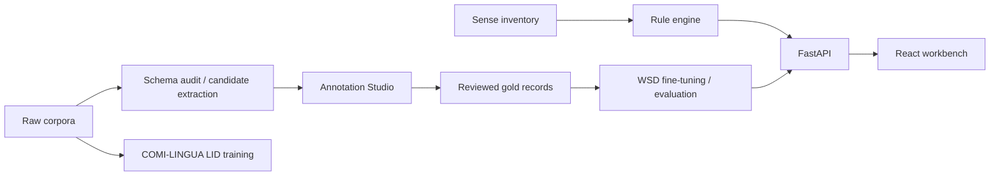

# Architecture

The FastAPI service currently serves only the verified deterministic methods. It never advertises untrained neural inference as available. All paths derive from repository root or SENSEFORGE_DATA_ROOT.
