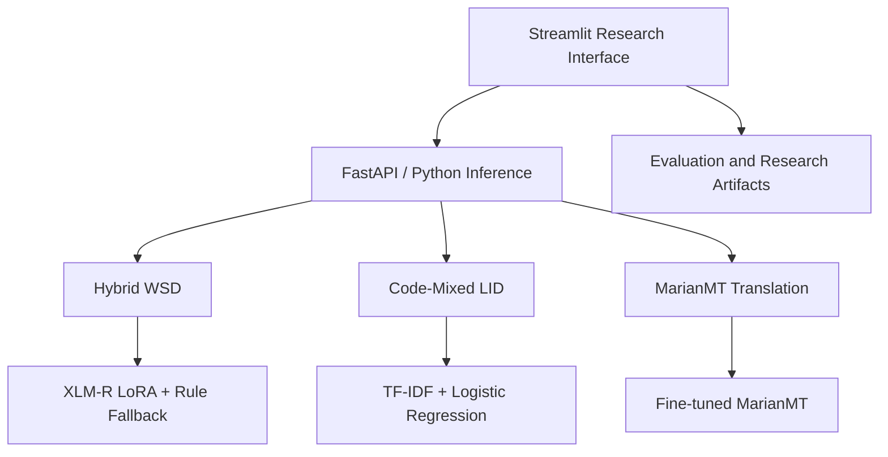

 <div align="center">

# Contexta

### Context-Aware Multilingual Intelligence

*Resolving meaning across languages.*

**A multilingual NLP research platform combining contextual word sense disambiguation, code-mixed language identification, and neural machine translation.**


**20 Research Notebooks · 35 Ambiguous Words · 3 NLP Tasks**

</div>

---

## Overview

**Contexta**, developed under the SenseForge research project, investigates how linguistic context determines the meaning of ambiguous English words and how multilingual information can support Hindi–English language understanding.

The system integrates interpretable lexical rules, classical machine learning, transformer-based contextual representations, and neural sequence-to-sequence translation.

### Core capabilities

- **Contextual Word Sense Disambiguation:** Resolve ambiguous English words into contextually appropriate Hindi meanings.
- **Hybrid WSD:** Combine XLM-RoBERTa LoRA predictions with transparent rule-based fallback.
- **Code-Mixed Language Identification:** Classify Hindi, English, and other tokens in multilingual text.
- **Neural Machine Translation:** Experimental English-to-Hindi sentence translation using fine-tuned MarianMT.
- **Research Analytics:** Explore model comparisons, evaluation results, ablation studies, and experiment metadata.
- **Interactive Application:** Streamlit research dashboard backed by Python inference services and FastAPI.

## Research Results

### Word Sense Disambiguation

The WSD system combines a 35-word curated sense inventory with a neural model trained for six ambiguous lemmas: `bank`, `interest`, `plant`, `point`, `right`, and `table`.

| Model | Accuracy | Macro-F1 |
|---|---:|---:|
| Dictionary | 38.71% | 0.2923 |
| Rule-Based | 46.77% | 0.4033 |
| Logistic Regression | 100.00% | 1.0000 |
| Residual MLP | 100.00% | 1.0000 |
| XLM-R LoRA | 98.39% | 0.9896 |
| Hybrid LoRA | 98.39% | 0.9896 |

*Evaluation: custom 62-example WSD V2 test partition. These results do not establish general-purpose WSD accuracy.*

### Code-Mixed Language Identification

**Model:** Character-level TF-IDF with Logistic Regression.

| Metric | Held-out test |
|---|---:|
| Accuracy | **94.81%** |
| Macro-F1 | **0.9293** |
| Test tokens | **91,173** |

The original six-class annotation scheme was normalized experimentally to `hi`, `en`, and `other`. Leakage-safe splits were constructed after identifying overlapping sentences in the original files.

### Neural Machine Translation

**Model:** `Helsinki-NLP/opus-mt-en-hi` (MarianMT).

Fine-tuned using 6,000 IIT-B and 2,000 Samanantar English–Hindi sentence pairs.

| Metric | Pretrained | Fine-tuned |
|---|---:|---:|
| SacreBLEU | 9.6598 | **9.9229** |
| chrF | 31.8254 | **31.9310** |

*Evaluation: 300 held-out sentence pairs. Translation quality remains experimental, and generated sentences can contain semantic errors.*

## System Architecture



The Streamlit application is the current primary interface. The original React/Vite frontend is retained as an alternative implementation.

## Project Structure

```text
Contexta/
├── backend/             # FastAPI backend
├── frontend/            # React + Vite interface
├── streamlit_app/       # Primary research interface
├── src/senseforge/      # NLP models and inference
├── notebooks/           # 20 research notebooks
├── configs/             # Sense inventory and mappings
├── research_results/    # Versioned evaluation reports
├── scripts/             # Training and setup utilities
└── tests/               # API and regression tests
```

The local development folder remains named `SenseForge` for compatibility with existing research paths.

## Datasets

| Dataset | Purpose |
|---|---|
| Comi-Lingua | Hindi–English code-mixed language identification |
| IIT-B English–Hindi | Parallel translation data |
| Samanantar | Supplementary English–Hindi translation training |
| XL-WSD / SemCor-derived resources | WSD research and benchmark investigation |

Original datasets are not committed to this repository.

The local directory arrangement is:

```text
NLP project/
├── Comi-Lingua/
├── Data_IIT-B_Hugging_Face/
├── Dataset_Samanantar/
└── SenseForge/
```

Only four of the eight Samanantar shards were available during the recorded experiments.

## Installation

### Requirements

- Python 3.11
- Git
- Compatible PyTorch and Transformers dependencies
- Locally available trained checkpoints for neural inference

Clone the repository:

```bash
git clone https://github.com/SuvratJoshi2275/Contexta.git
cd Contexta

python3.11 -m venv .venv
source .venv/bin/activate

python -m pip install -r backend/requirements.txt
python -m pip install -r streamlit_app/requirements.txt
python -m pip install -r requirements-ml.txt
```

The GitHub repository does not include the fine-tuned model weights or original multi-gigabyte datasets.

### Required local model artifacts

```text
artifacts/
├── wsd_v2_lora/
│   ├── best_lora_adapter/
│   └── best_classifier_head.pt
├── hybrid_v2/
│   └── hybrid_config.json
├── senseforge_final/
│   └── comilingua_lid/training_v1/
│       └── normalized_3class/
│           └── comilingua_lid_3class.joblib
└── translation_v1/
    └── finetuned/best_model/
```

The WSD service additionally loads the pretrained `xlm-roberta-base` encoder.

### Start FastAPI

```bash
uvicorn backend.main:app --host 127.0.0.1 --port 8000
```

API documentation: `http://127.0.0.1:8000/docs`

### Start Streamlit

In a separate terminal:

```bash
source .venv/bin/activate
streamlit run streamlit_app/app.py
```

Application: `http://localhost:8501`

### Optional React frontend

```bash
cd frontend
npm ci
npm run dev
```

Application: `http://127.0.0.1:5173`

## Research Notebooks

| # | Research stage |
|---:|---|
| 01 | Dataset Audit & EDA |
| 02 | Corpus Preprocessing |
| 03 | Ambiguity Extraction |
| 04 | Improved Sense Annotation |
| 05 | Dictionary Baseline |
| 06 | Rule-Based WSD |
| 07 | XLM-R Prototype Training |
| 08 | XLM-R Supervised Training |
| 09 | Hinglish LID Training |
| 10 | Hybrid WSD |
| 11 | Model Evaluation |
| 12 | Ablations & Error Analysis |
| 13 | Advanced Neural WSD |
| 14 | Robustness & Generalization Evaluation |
| 15 | XLM-R Parameter-Efficient Fine-tuning |
| 16 | Independent WSD Benchmark |
| 17 | Research Integration and Dataset Preparation |
| 18 | Comi-Lingua Token-Level LID Training |
| 19 | English–Hindi Neural Machine Translation |
| 20 | End-to-End Inference Integration |

Detailed results and research metadata are available in [`research_results/`](research_results/).

## Research Limitations

- Neural WSD currently supports six ambiguous English lemmas.
- The custom WSD evaluation partition is small.
- Code-mixed WSD generalization has not been directly established.
- The normalized LID label mapping is provisional.
- MarianMT translation quality is limited.
- Some historical experiments require locally archived intermediate artifacts.
- The Streamlit application has been launched locally, but complete functional verification remains ongoing.

## Roadmap

- [x] Dictionary and rule-based WSD
- [x] Supervised WSD and XLM-R LoRA
- [x] Hybrid inference
- [x] Leakage-safe Comi-Lingua LID
- [x] English–Hindi MarianMT fine-tuning
- [x] Unified Python inference service
- [x] FastAPI integration
- [x] Initial Streamlit research application
- [ ] Comprehensive 30+ word evaluation
- [ ] Direct code-mixed WSD benchmark
- [ ] Streamlit UI refinement and complete regression testing
- [ ] Model checkpoint distribution for collaborators

## Collaboration

Contexta is an active research project. Contributions should preserve reproducibility, distinguish measured results from demonstrations, and avoid committing datasets, model weights, credentials, or machine-specific environments.

**Repository:** [github.com/SuvratJoshi2275/Contexta](https://github.com/SuvratJoshi2275/Contexta)

---

<div align="center">

### Contexta — Context-Aware Multilingual Intelligence

*From lexical ambiguity to multilingual understanding.*

</div>