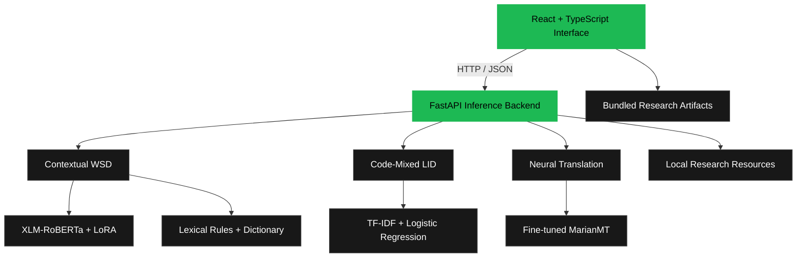

 <div align="center">

# ◈ CONTEXTA

### Context-Aware Multilingual Intelligence

**Resolving meaning across languages.**

*A research-driven NLP platform for contextual understanding, multilingual intelligence, and neural language processing.*

<br>


<br>


<br>

**35 Ambiguous Words &nbsp;·&nbsp; 70 Curated Senses &nbsp;·&nbsp; 20 Research Notebooks &nbsp;·&nbsp; 12 Research Modules**

<br>

[**Explore the Research**](#-research-results) &nbsp;·&nbsp;
[**System Architecture**](#-system-architecture) &nbsp;·&nbsp;
[**Get Started**](#-getting-started) &nbsp;·&nbsp;
[**Research Limitations**](#-research-limitations)

</div>

---

## ◈ The Idea

> **A word does not carry its meaning in isolation. Context determines interpretation.**

Consider the word **bank**.

| Context | Meaning | Hindi interpretation |
|:---|:---|:---|
| *The fisherman sat on the bank.* | River shore | **किनारा** |
| *The bank approved the loan.* | Financial institution | **बैंक** |

A conventional dictionary may return a default meaning regardless of context.

**Contexta investigates how contextual representations, interpretable lexical rules, and neural models can resolve this ambiguity.**

Originally developed under the **SenseForge** research initiative, Contexta has evolved into an integrated multilingual NLP platform supporting word sense disambiguation, code-mixed language identification, and neural machine translation.

The project connects research notebooks and trained models to a functional, interactive application.

---

## ◈ Research at a Glance

<div align="center">

| 35 | 70 | 20 | 12 |
|:---:|:---:|:---:|:---:|
| **Ambiguous Lemmas** | **Curated Senses** | **Research Notebooks** | **Application Modules** |

</div>

### Three interconnected NLP tasks

| Research area | Approach | Objective |
|---|---|---|
| **Word Sense Disambiguation** | XLM-RoBERTa + LoRA + lexical rules | Resolve context-dependent meanings |
| **Code-Mixed Language Identification** | Character TF-IDF + Logistic Regression | Identify Hindi, English, and Other tokens |
| **Neural Machine Translation** | Fine-tuned MarianMT | Generate experimental English-to-Hindi translations |

### Why Contexta?

- **Context-aware:** Goes beyond dictionary-only lexical lookup.
- **Hybrid intelligence:** Combines neural inference with interpretable rules.
- **Multilingual:** Investigates English, Hindi, and code-mixed text.
- **Research-oriented:** Connects experiments, evaluations, and ablations.
- **Interactive:** Provides live inference through React and FastAPI.
- **Evidence-conscious:** Separates historical evaluation artifacts from live predictions.

---

## ◈ Application Experience

### A research laboratory, not just a prediction interface.

Contexta features a Spotify-inspired dark interface built with **React, TypeScript, Vite, and Recharts**.

Its design uses layered charcoal surfaces, emerald-green interaction accents, contextual workspaces, responsive navigation, and interactive research visualizations.

The frontend communicates with the existing Python FastAPI backend and displays saved research evidence separately from live inference.

### The 12 Research Modules

| Module | Capabilities |
|---|---|
| **01 · Research Overview** | Platform metrics, model readiness, and research summaries |
| **02 · Contextual WSD Laboratory** | Target-aware word sense prediction and interpretation |
| **03 · Code-Mixed Language ID** | Hindi–English token classification |
| **04 · Neural Translation Studio** | English-to-Hindi MarianMT inference |
| **05 · Model Comparison Laboratory** | Dictionary, rules, neural, and hybrid comparisons |
| **06 · Sense Inventory Explorer** | Searchable lexical inventory and Hindi glosses |
| **07 · Dataset Intelligence** | Dataset provenance, statistics, and audits |
| **08 · Evaluation & Benchmarking** | Accuracy, F1, BLEU, chrF, and experimental reports |
| **09 · Ablation & Error Analysis** | Component analysis, calibration, and robustness |
| **10 · Batch Processing** | CSV-based inference and downloadable results |
| **11 · Annotation Studio** | Candidate review and human sense annotation |
| **12 · Experiments & Research Registry** | Notebook lineage and research artifacts |

### Interface Gallery

The application includes:

**Research Overview** — Model availability, platform statistics, and historical evidence.

**Contextual WSD Laboratory** — Highlighted target spans, predicted Hindi meanings, sense identifiers, and inference traces.

**Model Comparison** — Side-by-side predictions from dictionary, rule-based, neural, and hybrid approaches.

**Evaluation & Benchmarking** — Interactive research charts and source-linked metric reports.

*Application screenshots can be added here once committed to the repository.*

---

## ◈ Research Results

All metrics below originate from saved experimental reports.

**These results describe specific evaluation partitions. They are not claims of universal model performance or independently established generalization.**

### 01 / Contextual Word Sense Disambiguation

**Research configuration**

- Curated inventory: 35 ambiguous lemmas, 70 senses.
- Neural coverage: six ambiguous English lemmas.
- Encoder: `xlm-roberta-base`.
- Adaptation: Low-Rank Adaptation (LoRA).
- Hybrid routing: Neural inference with lexical rule fallback.
- Evaluation: Custom 62-example WSD V2 test partition.

**Neural-supported lemmas**

`bank` · `interest` · `plant` · `point` · `right` · `table`

#### Model Comparison

| Model | Accuracy | Macro-F1 |
|:---|---:|---:|
| Dictionary Baseline | 38.71% | 0.2923 |
| Rule-Based WSD | 46.77% | 0.4033 |
| Logistic Regression | 100.00% | 1.0000 |
| Residual MLP | 100.00% | 1.0000 |
| **XLM-R LoRA** | **98.39%** | **0.9896** |
| **Hybrid LoRA** | **98.39%** | **0.9896** |

**Interpretation**

The neural and hybrid approaches outperform the dictionary and lexical-rule baselines on the recorded custom evaluation partition.

The perfect classical-model scores are historical experimental results from the same small benchmark and should not be interpreted as proof of general-purpose performance.

**Scientific caution:** The 62-example test partition is insufficient to establish broad WSD generalization. Independent evaluation remains necessary.

### 02 / Code-Mixed Language Identification

**Model:** Character-level TF-IDF + Logistic Regression

<div align="center">

| Metric | Held-out test |
|:---|---:|
| **Accuracy** | **94.81%** |
| **Macro-F1** | **0.9293** |
| Evaluated tokens | 91,173 |

</div>

**Example**

```text
Input: Hello mujhe bank jaana hai

Hello   → en
mujhe   → hi
bank    → en
jaana   → hi
hai     → hi
```

The original six-class Comi-Lingua annotation scheme was experimentally normalized into three categories:

`hi` · `en` · `other`

Sentence-disjoint splits were constructed after identifying overlapping sentences in the original dataset files.

The normalized three-class mapping remains provisional.

### 03 / Neural Machine Translation

**Architecture:** MarianMT  
**Base model:** `Helsinki-NLP/opus-mt-en-hi`

**Fine-tuning corpus**

- 6,000 IIT-B English–Hindi sentence pairs.
- 2,000 Samanantar English–Hindi sentence pairs.

#### Translation Benchmark

| Metric | Pretrained | Fine-tuned |
|:---|---:|---:|
| SacreBLEU | 9.6598 | **9.9229** |
| chrF | 31.8254 | **31.9310** |

Evaluation: **300 held-out sentence pairs**.

The fine-tuned model shows modest improvements on the recorded test partition.

**Research caution:** Translation quality remains limited. Generated sentences may contain semantic errors and should not be treated as reliable translations without review.

---

## ◈ System Architecture

Contexta follows a modular frontend–backend architecture.



### Technology Stack

| Layer | Technologies |
|---|---|
| **Frontend** | React, TypeScript, Vite |
| **UI & Visualization** | Custom CSS, Recharts |
| **Backend** | FastAPI, Python 3.11 |
| **Deep Learning** | PyTorch, Hugging Face Transformers |
| **Neural WSD** | XLM-RoBERTa, LoRA |
| **Classical ML** | Scikit-learn, TF-IDF, Logistic Regression |
| **Translation** | MarianMT |
| **Research** | Jupyter, NumPy, Pandas |
| **Version Control** | Git, GitHub |

---

## ◈ Repository Structure

```text
Contexta/
│
├── frontend/                 # Primary React application
│   ├── src/
│   │   ├── components/       # Shared UI components
│   │   ├── views/            # 12 research modules
│   │   ├── services/         # Typed FastAPI client
│   │   ├── data/             # Bundled research JSON artifacts
│   │   ├── types/            # TypeScript interfaces
│   │   └── utils/            # NLP and frontend utilities
│   └── package.json
│
├── backend/                  # FastAPI endpoints
├── src/senseforge/           # Python NLP inference package
├── notebooks/                # 20 research notebooks
├── configs/                  # Sense inventory and configuration
├── research_results/         # Historical evaluation evidence
├── artifacts/                # Local trained checkpoints and artifacts
├── datasets/                 # Local datasets (not distributed)
├── scripts/                  # Research and setup utilities
├── tests/                    # API and regression tests
│
├── requirements-ml.txt
└── README.md
```

The internal Python package retains the name `senseforge` for compatibility with existing imports and research artifacts.

The public-facing platform is **Contexta**.

---

## ◈ Datasets & Research Corpora

Contexta integrates four research data sources.

| Dataset | Primary purpose |
|---|---|
| **Comi-Lingua** | Hindi–English code-mixed language identification |
| **IIT-B English–Hindi** | Parallel sentence training and translation evaluation |
| **Samanantar** | Supplementary English–Hindi translation corpus |
| **XL-WSD / SemCor** | Multilingual WSD research and benchmark investigation |

### Local Dataset Layout

```text
Contexta/
└── datasets/
    ├── Comi-Lingua/
    ├── Data_IIT-B_Hugging_Face/
    ├── Dataset_Samanantar/
    └── xl-wsd/
```

**Dataset availability note:** Only four of the eight Samanantar shards were available during the recorded experiments.

The original multi-gigabyte datasets are not included in this GitHub repository.

---

## ◈ Getting Started

### Prerequisites

- Python 3.11
- Node.js and npm
- Git
- Compatible PyTorch and Transformers dependencies
- Local trained checkpoints for neural inference

### 1. Clone the Repository

```bash
git clone https://github.com/SuvratJoshi2275/Contexta.git
cd Contexta
```

### 2. Configure the Python Environment

```bash
python3.11 -m venv .venv
source .venv/bin/activate

python -m pip install -r backend/requirements.txt
python -m pip install -r requirements-ml.txt
```

### 3. Restore Trained Model Artifacts

The GitHub repository does not distribute trained model weights.

The local model directory should include:

```text
artifacts/
├── wsd_v2_lora/
│   ├── best_lora_adapter/
│   └── best_classifier_head.pt
│
├── hybrid_v2/
│   └── hybrid_config.json
│
├── senseforge_final/
│   └── comilingua_lid/
│       └── training_v1/
│           └── normalized_3class/
│               └── comilingua_lid_3class.joblib
│
└── translation_v1/
    └── finetuned/
        └── best_model/
```

The neural WSD pipeline also requires the pretrained `xlm-roberta-base` encoder.

### 4. Start the FastAPI Backend

From the project root:

```bash
PYTHONPATH=src .venv/bin/python -m uvicorn backend.main:app --host 127.0.0.1 --port 8000
```

**API documentation:** http://127.0.0.1:8000/docs

**Health endpoint:** http://127.0.0.1:8000/api/health

### 5. Launch the React Interface

Open another terminal:

```bash
cd frontend
npm ci
npm run dev -- --host 127.0.0.1 --port 5173
```

**Application:** http://127.0.0.1:5173

### Production Build

```bash
cd frontend
npm ci
npm run build
```

The frontend has been successfully built from a fresh GitHub clone using TypeScript and Vite.

This verifies frontend build reproducibility, not full model-training reproducibility.

---

## ◈ API Reference

The FastAPI backend exposes the following interfaces.

<details>
<summary><b>View available API endpoints</b></summary>

<br>

| Method | Endpoint | Description |
|---|---|---|
| GET | `/api/health` | Service and model readiness |
| GET | `/api/inventory` | Curated lexical inventory |
| GET | `/api/detect` | Detect ambiguous words |
| POST | `/api/predict` | Contextual WSD inference |
| POST | `/api/compare` | Multi-model WSD comparison |
| POST | `/api/lid` | Code-mixed language identification |
| POST | `/api/translate` | Neural translation |
| POST | `/api/batch` | CSV batch inference |
| GET | `/api/datasets` | Dataset audit information |
| GET | `/api/experiments` | Experiment metadata |
| GET | `/api/candidates` | Annotation candidates |
| GET | `/api/annotations` | Saved annotation records |
| POST | `/api/annotations` | Save sense annotations |

</details>

---

## ◈ Research Notebook Lineage

Contexta contains **20 Jupyter notebooks**, progressing from dataset exploration and lexical baselines to transformer adaptation and end-to-end integration.

<details>
<summary><b>View all 20 research notebooks</b></summary>

<br>

| # | Research stage |
|---:|---|
| 01 | Dataset Audit & Exploratory Data Analysis |
| 02 | Corpus Preprocessing |
| 03 | Ambiguity Extraction |
| 04 | Improved Sense Annotation |
| 05 | Dictionary Baseline |
| 06 | Rule-Based WSD |
| 07 | XLM-R Prototype Training |
| 08 | XLM-R Supervised Training |
| 09 | Hinglish LID Training |
| 10 | Hybrid WSD |
| 11 | Model Evaluation |
| 12 | Ablations & Error Analysis |
| 13 | Advanced Neural WSD |
| 14 | Robustness & Generalization Evaluation |
| 15 | XLM-R Parameter-Efficient Fine-tuning |
| 16 | Independent WSD Benchmark |
| 17 | Research Integration & Dataset Preparation |
| 18 | Comi-Lingua Token-Level LID Training |
| 19 | English–Hindi Neural Machine Translation |
| 20 | End-to-End Inference Integration |

</details>

Detailed research outputs are available in [`research_results/`](research_results/).

---

## ◈ Evaluation & Verification

### Verified Application Workflows

The following functionality has been tested locally:

- React frontend compilation and production build.
- Fresh-clone frontend build.
- FastAPI health and checkpoint readiness.
- Contextual WSD live inference.
- Token-level Hindi–English LID.
- Experimental MarianMT inference.
- Multi-model WSD comparison.
- Per-row hybrid batch processing.
- Direct CSV batch processing.
- Historical research artifact visualization.

### Annotation Studio Status

The Annotation Studio interface and empty candidate state have been verified.

The backend expects the candidate queue at:

`artifacts/candidates.jsonl`

This file was absent in the tested environment.

Candidate generation, human labeling, and annotation saving therefore remain incomplete.

---

## ◈ Research Limitations

Contexta is an academic research platform, not a production-validated multilingual NLP service.

<details open>
<summary><b>Scientific scope and known limitations</b></summary>

<br>

- **Limited neural coverage:** XLM-R LoRA currently supports six ambiguous English lemmas.
- **Small WSD evaluation:** The custom test partition contains only 62 examples.
- **Generalization:** Independent large-scale WSD validation remains incomplete.
- **Code-mixed WSD:** Direct generalization to code-switched contexts has not been established.
- **LID normalization:** The three-class label mapping remains provisional.
- **Confidence calibration:** Neural softmax outputs are not calibrated correctness probabilities.
- **Translation quality:** MarianMT outputs may contain significant semantic errors.
- **Rule-based fallback:** Lexical rules may fail without explicit contextual cues.
- **Dataset integrity:** Additional source-level leakage and near-duplicate auditing may be necessary.
- **Research reproducibility:** Some historical experiments require locally archived intermediate artifacts.
- **Annotation workflow:** Candidate extraction and full annotation verification remain incomplete.
- **Model distribution:** Fine-tuned checkpoints and original datasets are not bundled with the GitHub source.

</details>

---

## ◈ Development Roadmap

### Completed

- [x] Curated bilingual sense inventory
- [x] Dictionary-based WSD baseline
- [x] Rule-based contextual disambiguation
- [x] Classical supervised WSD experiments
- [x] XLM-RoBERTa LoRA inference
- [x] Hybrid neural–rule inference
- [x] Code-mixed token-level LID
- [x] Experimental MarianMT fine-tuning
- [x] FastAPI inference integration
- [x] Spotify-inspired React + TypeScript interface
- [x] Twelve interactive research modules
- [x] Live WSD, LID, translation, and model comparison
- [x] Batch inference workflows
- [x] Bundled research evidence visualization
- [x] Fresh-clone frontend build verification

### Next Research Milestones

- [ ] Complete annotation candidate extraction and adjudication
- [ ] Expand neural WSD beyond six lemmas
- [ ] Establish independent WSD benchmarks
- [ ] Evaluate direct code-mixed WSD performance
- [ ] Improve MarianMT translation quality
- [ ] Expand robustness and error analysis
- [ ] Optimize frontend bundle size
- [ ] Improve collaborator checkpoint distribution

---

## ◈ Collaboration & Reproducibility

Contexta is an active academic research project.

Contributions should prioritize:

- Reproducible experimental procedures.
- Transparent evaluation and provenance.
- Separation of live predictions from saved research metrics.
- Accurate documentation of model limitations.
- Compatibility with the existing FastAPI inference architecture.

Do not commit original large-scale datasets, trained model weights, credentials, virtual environments, or generated dependency directories.

**Repository:** [github.com/SuvratJoshi2275/Contexta](https://github.com/SuvratJoshi2275/Contexta)

---

<div align="center">

### ◈ CONTEXTA

**Context-Aware Multilingual Intelligence**

*From lexical ambiguity to multilingual understanding.*

<br>


<br>

**Built to explore how language acquires meaning through context.**

</div>
