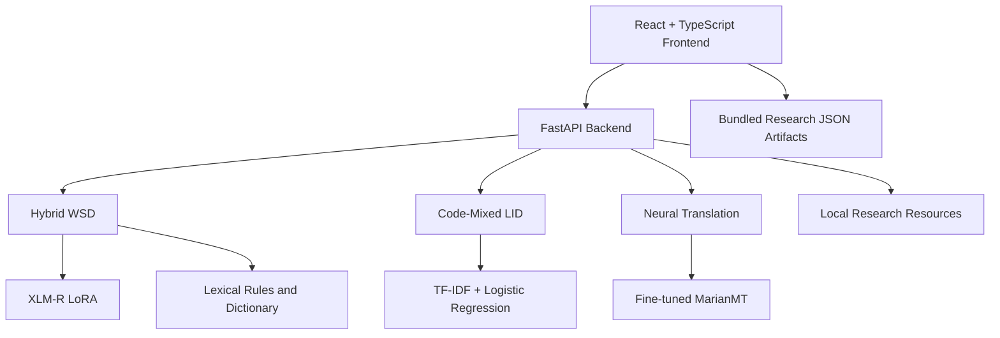

# Contexta

<div align="center">

### Context-Aware Multilingual Intelligence

*Resolving meaning across languages.*

**A research-driven multilingual NLP platform combining contextual word sense disambiguation, code-mixed language identification, and neural machine translation.**


**20 Research Notebooks · 35 Ambiguous Words · 70 Curated Senses · 12 Research Modules · 3 NLP Tasks**

</div>

---

## 1. Overview

**Contexta** is a multilingual natural language processing research platform developed under the SenseForge research initiative.

The project investigates how linguistic context influences the interpretation of ambiguous English words and how machine learning can support Hindi–English multilingual understanding.

Contexta combines interpretable lexical rules, classical machine learning, transformer-based contextual representations, parameter-efficient fine-tuning, and neural sequence-to-sequence translation.

Its primary application is a **Spotify-inspired React + TypeScript research interface** connected to a Python FastAPI inference backend.

The platform integrates three principal NLP tasks:

1. **Word Sense Disambiguation (WSD):** Identify the contextually appropriate Hindi meaning of an ambiguous English word.
2. **Code-Mixed Language Identification (LID):** Classify individual tokens as Hindi, English, or Other.
3. **Neural Machine Translation (NMT):** Generate experimental English-to-Hindi translations using fine-tuned MarianMT.

The application also provides interactive research analytics, model comparisons, ablation studies, dataset exploration, batch inference, and annotation workflows.

## 2. Core NLP Capabilities

### Contextual Word Sense Disambiguation

Contexta resolves lexical ambiguity by analyzing the surrounding sentence.

For example:

**Sentence A:** The fisherman sat on the bank.

- Target: `bank`
- Predicted sense: `bank.2`
- Hindi meaning: **किनारा**
- Interpretation: Riverbank

**Sentence B:** The bank approved the loan.

- Target: `bank`
- Predicted sense: `bank.1`
- Hindi meaning: **बैंक**
- Interpretation: Financial institution

The WSD system uses a curated inventory containing 35 ambiguous English lemmas and 70 Hindi sense entries.

Six lemmas have neural XLM-R LoRA support:

`bank`, `interest`, `plant`, `point`, `right`, `table`

The remaining 29 lemmas are handled through lexical rules and dictionary-based methods.

### Hybrid WSD Architecture

The hybrid inference pipeline combines:

- XLM-RoBERTa contextual representations.
- LoRA-based parameter-efficient adaptation.
- Target-aware neural sense classification.
- Lexical cue matching.
- Rule-based and dictionary fallback.
- Configurable hybrid decision thresholds.

Neural predictions are restricted to the supported six-lemma scope.

Raw softmax confidence values are not calibrated probabilities.

### Code-Mixed Language Identification

The language identification system performs token-level classification of Hindi–English code-mixed text.

**Example:**

Input: `Hello mujhe bank jaana hai`

| Token | Predicted language |
|---|---|
| Hello | English |
| mujhe | Hindi |
| bank | English |
| jaana | Hindi |
| hai | Hindi |

The deployed model uses character-level TF-IDF features with Logistic Regression.

The experimental label space consists of `hi`, `en`, and `other`.

The normalization from the original six-class annotation scheme is provisional.

### Neural Machine Translation

Contexta includes an experimental English-to-Hindi translation model based on:

`Helsinki-NLP/opus-mt-en-hi`

The MarianMT model was fine-tuned using 8,000 parallel sentence pairs:

- 6,000 IIT-B English–Hindi pairs.
- 2,000 Samanantar English–Hindi pairs.

The system supports live translation inference through FastAPI.

**Research limitation:** Generated translations may contain grammatical, lexical, or semantic errors. This model is an experimental research checkpoint, not a production-quality translation service.

---

## 3. Interactive Research Platform

Contexta features a Spotify-inspired dark interface built using React, TypeScript, Vite, and interactive data visualizations.

The design includes a persistent navigation sidebar, contextual research workspaces, model-status indicators, responsive layouts, and interactive charts.

### Available Research Modules

| Module | Functionality |
|---|---|
| Research Overview | Platform statistics, model readiness, and research summaries |
| Contextual WSD Laboratory | Live contextual sense prediction and evidence inspection |
| Code-Mixed Language ID | Token-level Hindi–English language classification |
| Neural Translation Studio | Experimental English-to-Hindi neural translation |
| Model Comparison Laboratory | Side-by-side comparison of WSD inference methods |
| Sense Inventory Explorer | Search and inspect curated word senses |
| Dataset Intelligence | Explore corpus statistics and dataset audits |
| Evaluation & Benchmarking | Inspect saved accuracy, F1, BLEU, and chrF results |
| Ablation & Error Analysis | Analyze model components, thresholds, and limitations |
| Batch Processing | Process CSV inputs through live inference endpoints |
| Annotation Studio | Review candidates and manage human sense annotations |
| Experiments & Research Registry | Inspect research artifacts and notebook lineage |

### Research Integrity

Contexta distinguishes three categories of information:

**Live FastAPI Inference**

Predictions generated by locally available trained models.

**Historical Research Artifacts**

Saved experimental results, evaluation reports, ablation studies, and benchmark records.

**Verified Sense Inventory**

Read-only lexical information derived from the curated inventory.

Historical research metrics are never presented as newly executed inference results.

When the backend is unavailable, live inference features are disabled rather than replaced with fabricated predictions.

---

## 4. Research Results

The following metrics originate from saved experimental reports. They describe specific evaluation partitions and should not be interpreted as universal model performance.

### 4.1 Word Sense Disambiguation

The WSD evaluation uses a custom 62-example test partition.

| Model | Accuracy | Macro-F1 |
|---|---:|---:|
| Dictionary | 38.71% | 0.2923 |
| Rule-Based | 46.77% | 0.4033 |
| Logistic Regression | 100.00% | 1.0000 |
| Residual MLP | 100.00% | 1.0000 |
| XLM-R LoRA | 98.39% | 0.9896 |
| Hybrid LoRA | 98.39% | 0.9896 |

**Important:** The Logistic Regression and Residual MLP results are historical experimental benchmarks, not independently deployed live inference adapters.

Perfect scores on a small custom test partition do not establish general-purpose WSD accuracy.

### 4.2 Code-Mixed Language Identification

**Model:** Character-level TF-IDF + Logistic Regression.

| Metric | Held-out test |
|---|---:|
| Accuracy | **94.81%** |
| Macro-F1 | **0.9293** |
| Test tokens | **91,173** |

Sentence-disjoint splits were constructed after identifying overlapping sentences in the original dataset files.

The three-class label mapping remains provisional.

### 4.3 Neural Machine Translation

**Model:** Fine-tuned MarianMT.

| Metric | Pretrained | Fine-tuned |
|---|---:|---:|
| SacreBLEU | 9.6598 | **9.9229** |
| chrF | 31.8254 | **31.9310** |

Evaluation was performed on 300 held-out sentence pairs.

These results indicate limited translation quality. Individual generated translations require semantic verification.

---

## 5. System Architecture



### Frontend

- React
- TypeScript
- Vite
- Recharts
- Custom dark design system

### Backend

- Python 3.11
- FastAPI
- PyTorch
- Hugging Face Transformers
- Scikit-learn
- Locally stored trained checkpoints

### Integration

The React application communicates with the FastAPI backend through HTTP endpoints.

The local development configuration uses a Vite proxy for `/api` requests to `http://127.0.0.1:8000`.

---

## 6. Project Structure

```text
Contexta/
├── backend/               # FastAPI application
├── frontend/              # Primary React + TypeScript UI
│   ├── src/
│   │   ├── components/    # Shared interface components
│   │   ├── views/         # 12 research modules
│   │   ├── services/      # FastAPI client
│   │   ├── data/          # Bundled research JSON artifacts
│   │   ├── types/         # TypeScript interfaces
│   │   └── utils/         # NLP and frontend utilities
│   └── package.json
├── src/senseforge/        # Internal NLP Python package
├── notebooks/             # 20 research notebooks
├── configs/               # Sense inventory and configuration
├── research_results/      # Saved evaluation evidence
├── artifacts/             # Local research and model artifacts
├── scripts/               # Training and setup utilities
├── tests/                 # API and regression tests
├── requirements-ml.txt
└── README.md
```

The internal `senseforge` package name is retained for compatibility with existing Python imports and research artifacts. The public-facing application is branded **Contexta**.

---

## 7. Datasets

| Dataset | Research purpose |
|---|---|
| Comi-Lingua | Hindi–English code-mixed language identification |
| IIT-B English–Hindi | Parallel translation training |
| Samanantar | Supplementary translation training |
| XL-WSD / SemCor-derived resources | WSD research and benchmark investigation |

The original multi-gigabyte datasets are not included in the GitHub repository.

Only four of the eight Samanantar shards were available during the recorded experiments.

Dataset paths and local research artifacts must be configured according to the installation environment.

---

## 8. Installation and Local Development

### Prerequisites

- Python 3.11
- Node.js and npm
- Git
- Compatible PyTorch and Transformers dependencies
- Trained checkpoints for live neural inference

### Clone Repository

```bash
git clone https://github.com/SuvratJoshi2275/Contexta.git
cd Contexta
```

### Set Up Python Environment

```bash
python3.11 -m venv .venv
source .venv/bin/activate

python -m pip install -r backend/requirements.txt
python -m pip install -r requirements-ml.txt
```

If a dependency installation requires platform-specific adjustments, use compatible versions for the local Python and PyTorch environment.

### Required Local Model Artifacts

```text
artifacts/
├── wsd_v2_lora/
│   ├── best_lora_adapter/
│   └── best_classifier_head.pt
├── hybrid_v2/
│   └── hybrid_config.json
├── senseforge_final/
│   └── comilingua_lid/
│       └── training_v1/
│           └── normalized_3class/
│               └── comilingua_lid_3class.joblib
└── translation_v1/
    └── finetuned/
        └── best_model/
```

The WSD inference pipeline also requires the pretrained `xlm-roberta-base` encoder.

Model checkpoints must be supplied separately.

### Terminal 1 — Start FastAPI

From the repository root:

```bash
PYTHONPATH=src .venv/bin/python -m uvicorn backend.main:app --host 127.0.0.1 --port 8000
```

API documentation:

`http://127.0.0.1:8000/docs`

Health endpoint:

`http://127.0.0.1:8000/api/health`

### Terminal 2 — Start React Frontend

```bash
cd frontend
npm ci
npm run dev -- --host 127.0.0.1 --port 5173
```

Open:

**http://127.0.0.1:5173**

The frontend can display bundled research artifacts without live model access, but inference requires the local FastAPI service and relevant checkpoints.

### Production Build

```bash
cd frontend
npm ci
npm run build
```

A fresh GitHub clone was successfully compiled using TypeScript and Vite.

This verifies frontend build reproducibility, not full model-training reproducibility.

---

## 9. FastAPI Endpoints

| Method | Endpoint | Purpose |
|---|---|---|
| GET | `/api/health` | Service and checkpoint readiness |
| GET | `/api/inventory` | Curated sense inventory |
| GET | `/api/detect` | Detect supported ambiguous words |
| POST | `/api/predict` | Contextual WSD inference |
| POST | `/api/compare` | Multi-model WSD comparison |
| POST | `/api/lid` | Token-level language identification |
| POST | `/api/translate` | Neural translation |
| POST | `/api/batch` | CSV batch processing |
| GET | `/api/datasets` | Dataset audit information |
| GET | `/api/experiments` | Experiment metadata |
| GET | `/api/candidates` | Annotation candidate queue |
| GET | `/api/annotations` | Saved annotation records |
| POST | `/api/annotations` | Save annotation records |

---

## 10. Research Notebooks

| # | Research stage |
|---:|---|
| 01 | Dataset Audit & EDA |
| 02 | Corpus Preprocessing |
| 03 | Ambiguity Extraction |
| 04 | Improved Sense Annotation |
| 05 | Dictionary Baseline |
| 06 | Rule-Based WSD |
| 07 | XLM-R Prototype Training |
| 08 | XLM-R Supervised Training |
| 09 | Hinglish LID Training |
| 10 | Hybrid WSD |
| 11 | Model Evaluation |
| 12 | Ablations & Error Analysis |
| 13 | Advanced Neural WSD |
| 14 | Robustness & Generalization Evaluation |
| 15 | XLM-R Parameter-Efficient Fine-tuning |
| 16 | Independent WSD Benchmark |
| 17 | Research Integration and Dataset Preparation |
| 18 | Comi-Lingua Token-Level LID Training |
| 19 | English–Hindi Neural Machine Translation |
| 20 | End-to-End Inference Integration |

Research outputs and supporting reports are available in [`research_results/`](research_results/).

---

## 11. Verification Status

The following functionality has been tested locally:

- React frontend TypeScript compilation and production build.
- Fresh GitHub clone followed by `npm ci` and `npm run build`.
- FastAPI connectivity and checkpoint readiness.
- Live contextual WSD inference.
- Live token-level code-mixed LID.
- Live MarianMT translation.
- Multi-model WSD comparison.
- Per-row hybrid batch processing.
- Direct CSV batch processing.
- Historical research artifact rendering.

### Annotation Workflow

The Annotation Studio interface and empty candidate state have been verified.

The current backend expects candidates at:

`artifacts/candidates.jsonl`

Candidate extraction has not yet populated this file in the tested environment. Consequently, candidate labeling and annotation saving have not been fully verified through the React interface.

---

## 12. Research Limitations

Contexta is an academic research platform with several important limitations:

- Neural WSD currently supports six ambiguous English lemmas.
- The custom WSD evaluation partition contains only 62 examples.
- Historical benchmark results should not be interpreted as independent generalization evidence.
- Code-mixed WSD generalization has not been independently established.
- The three-class LID mapping remains provisional.
- Softmax confidence scores are not calibrated probabilities.
- MarianMT translations can contain significant semantic errors.
- The rule-based and dictionary fallbacks may fail when lexical evidence is insufficient.
- Near-duplicate and source-level leakage require further independent auditing.
- Some experiments depend on locally archived intermediate artifacts.
- Full annotation candidate generation and adjudication remain incomplete.
- The GitHub repository does not distribute the trained checkpoints or original datasets.

---

## 13. Development Roadmap

### Completed

- [x] Curated bilingual sense inventory
- [x] Dictionary and rule-based WSD
- [x] Classical supervised WSD experiments
- [x] XLM-R LoRA inference
- [x] Hybrid WSD integration
- [x] Code-mixed token-level LID
- [x] Experimental MarianMT fine-tuning
- [x] Unified FastAPI inference service
- [x] Spotify-inspired React + TypeScript frontend
- [x] Twelve interactive research modules
- [x] Live WSD, LID, translation, and comparison integration
- [x] Per-row and direct CSV batch inference
- [x] Bundled research artifact visualization
- [x] Fresh-clone frontend build verification

### Future Work

- [ ] Complete annotation candidate extraction and adjudication workflow
- [ ] Expand neural WSD coverage beyond six lemmas
- [ ] Conduct independent and larger-scale WSD evaluation
- [ ] Establish direct code-mixed WSD benchmarks
- [ ] Improve MarianMT translation quality
- [ ] Expand error analysis and robustness testing
- [ ] Optimize frontend bundle size and dependency versions
- [ ] Improve collaborator checkpoint distribution and setup documentation

---

## 14. Collaboration

Contexta is an active academic research project.

Contributors should preserve experimental reproducibility, distinguish saved evaluation evidence from live predictions, and document model limitations.

Do not commit:

- Original large-scale datasets
- Trained model weights
- API credentials
- Local virtual environments
- Generated dependency directories
- Machine-specific temporary files

**Repository:** [github.com/SuvratJoshi2275/Contexta](https://github.com/SuvratJoshi2275/Contexta)

---

<div align="center">

### Contexta — Context-Aware Multilingual Intelligence

*From lexical ambiguity to multilingual understanding.*

**Research-driven. Context-aware. Multilingual.**

</div>
